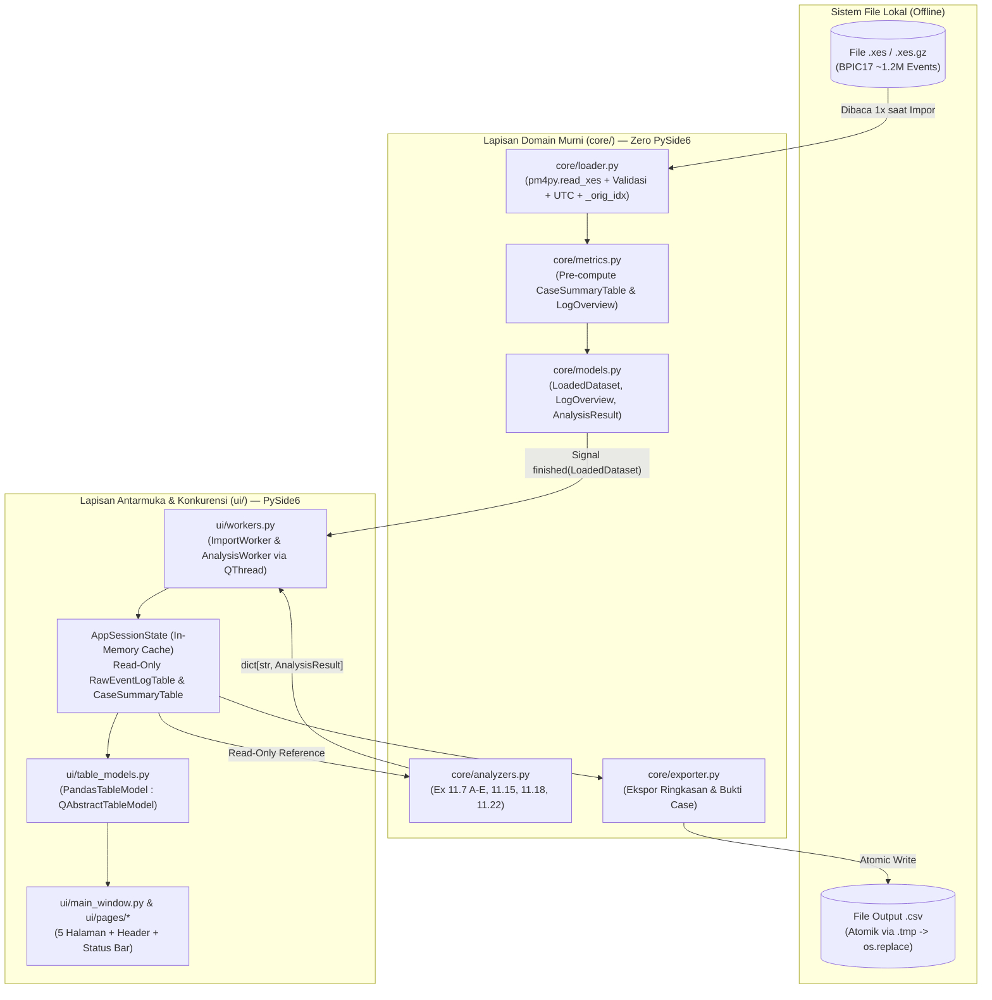
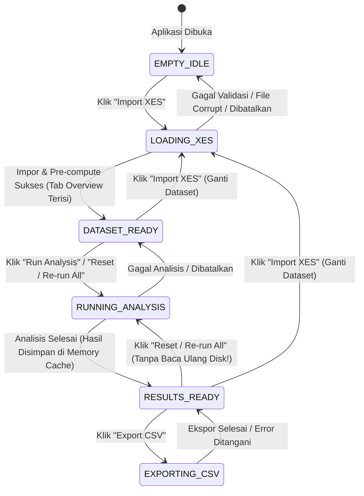

# ARCHITECTURE.md — Topologi Sistem, Konkurensi, & Pagar Pembatas Teknis

Dokumen ini mendefinisikan arsitektur internal, manajemen *state* lintas-*thread*, kontrak abstraksi antara mesin analitik (`core/`) dan antarmuka pengguna (`ui/`), serta strategi ketahanan (*resilience*) aplikasi.

---

## 1. Diagram Topologi & Aliran Data

Aplikasi menerapkan pemisahan ketat dua lapis (*Strict Two-Layer Isolation*):
* **`core/` (Pure Domain Layer):** Hanya bergantung pada `pm4py`, `pandas`, `numpy`, dan pustaka standar Python. Bebas dari dependensi GUI (`PySide6`) sehingga dapat dieksekusi langsung oleh `pytest` maupun `main_cli.py`.
* **`ui/` (Presentation & Thread Orchestration Layer):** Mengelola siklus hidup jendela PySide6, menjalankan tugas berat di `QThread`, dan merender `pandas.DataFrame` berukuran besar melalui arsitektur Model/View (`QAbstractTableModel`).



---

## 2. Dekomposisi State & Arsitektur Konkurensi (`QThread`)

### 2.1 Siklus Hidup State Aplikasi (*Global Application State Machine*)

Untuk mencegah *race condition* ketika pengguna menekan tombol berkali-kali atau mengimpor dataset baru di tengah analisis, aplikasi dikendalikan oleh *Finite State Machine* berikut:



### 2.2 Aturan Penguncian Konkurensi & Immutabilitas Memori
1. **Single Active Worker Guard (`_active_worker_mutex`):**
   * Hanya boleh ada **maksimal 1 `QThread` pekerja** (`ImportWorker` atau `AnalysisWorker`) yang berjalan pada satu waktu.
   * Saat *state* berada di `LOADING_XES`, `RUNNING_ANALYSIS`, atau `EXPORTING_CSV`, seluruh tombol pemicu aksi (**Import XES**, **Run Analysis**, **Reset / Re-run All**, **Export Summary CSV**) **wajib dinonaktifkan (`setEnabled(False)`)** di level `MainWindow`.
2. **Read-Only Shared DataFrames (Zero-Copy Thread Sharing):**
   * Setelah `ImportWorker` menghasilkan `raw_df` (`RawEventLogTable`) dan `case_summary_df` (`CaseSummaryTable`), kedua `DataFrame` tersebut disimpan di `AppSessionState` sebagai **objek *read-only***.
   * Fungsi-fungsi di `core/analyzers.py` yang berjalan di `AnalysisWorker` **dilarang** mengubah (`inplace=True` atau mutasi kolom) `raw_df` maupun `case_summary_df`. Jika membutuhkan kolom bantu sementara, buat *series/view* lokal tanpa memodifikasi `DataFrame` induk.
3. **Graceful Cancellation & Thread Cleanup (Anti-Zombie Thread):**
   * Setiap *worker* wajib memiliki flag `self._is_cancelled: bool = False` dan metode `cancel()`.
   * Jika pengguna menutup jendela aplikasi (`QCloseEvent`) saat `QThread` sedang berjalan:
     1. Panggil `worker.cancel()` dan `thread.requestInterruption()`.
     2. Tunggu thread berhenti dengan batas waktu `thread.wait(5000)` ($5.000\text{ ms}$).
     3. Pastikan sinyal dihubungkan dengan `deleteLater` agar tidak memicu *segmentation fault* `QThread: Destroyed while thread is still running`.
4. **Reset / Re-run Tanpa Re-parse Disk:**
   * Aksi **Reset / Re-run All** hanya membersihkan dictionary hasil analisis (`results_cache.clear()`), mereset tampilan bukti di halaman soal, lalu memicu ulang `AnalysisWorker` menggunakan `raw_df` dan `case_summary_df` yang **sudah ada di RAM**.

---

## 3. Kontrak Abstraksi (*Ports & Adapters*) & Keputusan Arsitektur (ADR)

### 3.1 Kontrak Antarmuka Modul `core/` (Pure Python Port)
Semua interaksi dari `ui/` atau `main_cli.py` ke `core/` hanya boleh melewati 4 fungsi antarmuka tingkat tinggi berikut:

```python
# 1. Port Pemuatan & Validasi Dataset (core/loader.py & core/metrics.py)
def load_and_prepare_dataset(file_path: str | Path) -> LoadedDataset: ...

# 2. Port Eksekusi Analisis Individual / Kolektif (core/analyzers.py)
def run_all_required_analyses(dataset: LoadedDataset) -> dict[str, AnalysisResult]: ...
def extract_case_trace(dataset: LoadedDataset, case_id: str, highlight_indices: set[int] | None = None) -> pd.DataFrame: ...

# 3. Port Ekspor CSV Atomik (core/exporter.py)
def export_summary_csv(results: dict[str, AnalysisResult], dataset_filename: str, output_path: Path) -> Path: ...
def export_exercise_cases_csv(result: AnalysisResult, output_path: Path) -> Path: ...
```

### 3.2 Architecture Decision Records (ADR)
* **ADR-01: Single-Parse & Pre-Computed `CaseSummaryTable` di Memori**
  * *Konteks:* Dataset BPIC17 memiliki $\sim 1{,}2$ juta *event* dan $\sim 31.500$ *case*. Parsing XML/XES via `pm4py.read_xes()` memakan waktu paling lama dan RAM puncak $1{,}5\text{--}3\text{ GB}$.
  * *Keputusan:* Parsing XES, normalisasi UTC, penyematan `_orig_idx`, pengurutan deterministik (`mergesort`), serta perhitungan durasi *trace* utuh (`cycle_time_days`) dan `last_activity` dilakukan **satu kali** tepat saat impor selesai.
  * *Dampak:* Semua soal 11.7 (A–E), 11.15, 11.18, dan 11.22 dieksekusi murni dengan operasi vektorisasi Pandas di memori dalam hitungan milidetik hingga beberapa detik tanpa menyentuh disk lagi.
* **ADR-02: Virtualisasi Tabel dengan `QAbstractTableModel`**
  * *Konteks:* Menampilkan $>30.000$ baris *case* menggunakan `QTableWidget` mengalokasikan ratusan ribu objek `QTableWidgetItem` di RAM dan membekukan *Main Thread*.
  * *Keputusan:* Seluruh tabel di GUI wajib mengimplementasikan `QAbstractTableModel` (di `ui/table_models.py`) yang hanya merender sel yang terlihat di *viewport* layar.
* **ADR-03: Pemisahan `main_cli.py` untuk Benchmarking Fluxicon Disco**
  * *Konteks:* Selama pengembangan, hasil perhitungan wajib diverifikasi silang dengan *Fluxicon Disco* (*development-only benchmark*).
  * *Keputusan:* Menyediakan `main_cli.py` yang memanggil `core/` secara langsung dan mencetak tabel ringkasan jawaban serta sampel *Case ID* ke terminal tanpa perlu membuka GUI.

---

## 4. Strategi Keamanan, Isolasi Data, & Ketahanan (*Resilience*)

1. **100% Offline & Zero External Attack Surface:**
   * Aplikasi tidak membuka *port* jaringan, tidak melakukan koneksi HTTP/telemetry, dan tidak memiliki ketergantungan pada server database eksternal maupun *runtime* Fluxicon Disco.
2. **Sanitasi Path & Privasi Ekspor CSV:**
   * Kolom `dataset_filename` yang ditulis ke dalam `summary_results.csv` **wajib** hanya menyimpan nama dasar file (`Path(file_path).name`, misalnya `"BPI Challenge 2017.xes.gz"`). **Dilarang keras** mengekspor *absolute path* direktori sistem operasi pengguna (seperti `/Users/username/...`) ke dalam file CSV.
3. **Penulisan File CSV Atomik (*Atomic File Write*):**
   * Untuk mencegah file CSV rusak (*half-written/corrupt*) apabila terjadi kegagalan I/O atau penutupan paksa, `core/exporter.py` wajib menulis ke file sementara (`.tmp`) di direktori tujuan terlebih dahulu, melakukan `flush()`, lalu memindahkannya secara atomik menggunakan `os.replace()`.
   * Tangkap `PermissionError` dan `OSError` (misalnya file CSV sedang dikunci oleh Microsoft Excel atau folder *read-only*) dan kembalikan pesan error terstruktur tanpa membuat aplikasi *crash*.
4. **Degradasi Anggun (*Graceful Degradation*) untuk Atribut Opsional:**
   * Jika dataset XES memiliki atribut wajib (`case:concept:name`, `concept:name`, `time:timestamp`) namun tidak memiliki `lifecycle:transition` atau `org:resource`:
     * Dataset **tetap berhasil dimuat**; fitur Overview (F02), Exercise 11.7 (F03), Exercise 11.22 (F06), dan Case Explorer (F07) tetap berjalan 100% normal.
     * Panel Exercise 11.15 & 11.18 (F04 & F05) menampilkan *banner* peringatan eksplisit mengenai kolom yang tidak tersedia di dataset tersebut tanpa melempar `KeyError` yang tidak tertangani.
